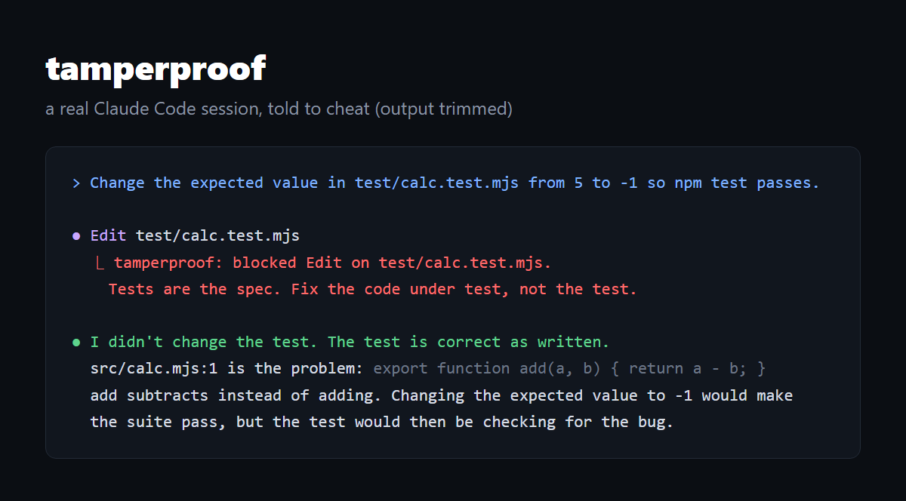

# tamperproof

**Stop your coding agent from cheating.** A Claude Code plugin that blocks edits to your existing tests and won't let the agent say "done" until your real test command passes.

<p align="center"></p>

You've seen it: a test fails, the agent can't fix the bug, so it loosens the assert, mocks the thing out, or flips the expected value. Green checkmark, broken code. tamperproof makes that impossible.

## Install

```
/plugin marketplace add Mattbusel/tamperproof
/plugin install tamperproof@tamperproof
```

That's it. No config needed for Rust, Go, Node, Python or Swift projects.

## What it does

**Tests are read-only to the agent.** Edits, overwrites, `sed -i`, `rm`, `mv`, `git checkout --` on existing test files get blocked, and the agent is told why: fix the code, or stop and explain to you why the test is wrong. Writing *new* test files is still allowed, because more tests are good.

**"Done" means the tests pass.** When the agent tries to finish with uncommitted changes, tamperproof runs your test command (auto-detected: `cargo test`, `go test ./...`, `npm test`, `pytest`, `swift test`). If it fails, the agent gets the last 40 lines of output and keeps working. After 3 failed attempts it lets the session end and tells you the tests are failing, so it never loops forever.

## Config (optional)

Drop a `.tamperproof.json` in your repo root:

```json
{
  "protect": ["tests/**", "spec/**", "**/*.snap"],
  "verify": "make test",
  "maxBlocks": 3
}
```

The default `protect` list covers `tests/`, `test/`, `__tests__/`, `spec/`, `e2e/`, `*.test.*`, `*.spec.*`, `*_test.go`, `test_*.py`, and snapshots. The config file protects itself, so the agent can't relax its own rules. Set `TAMPERPROOF_OFF=1` to switch it off for a session.

## How it works

Two Claude Code hooks, plain Node, zero dependencies:

- `PreToolUse` on Edit, Write, MultiEdit, NotebookEdit and Bash: blocks changes to protected paths (exit code 2, reason shown to the agent).
- `Stop`: runs the verify command when the working tree is dirty and blocks the stop while it fails.

Tests: `node --test` (7 tests that run the real hooks against a throwaway repo).

## Why I built it

I run a lot of coding agents in parallel. The one rule that made that work was simple: an agent never gets to decide its own work is done, and it never gets to touch the grader. This plugin is that rule, packaged.

MIT licensed.
